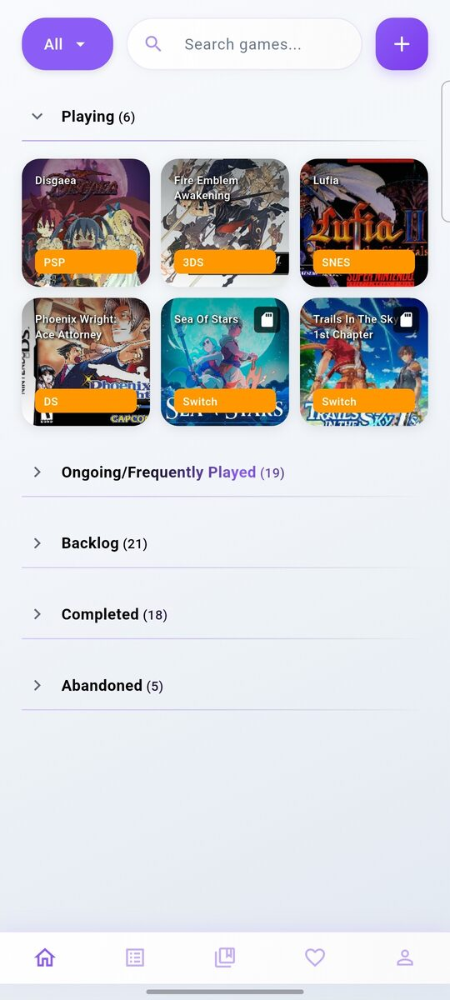
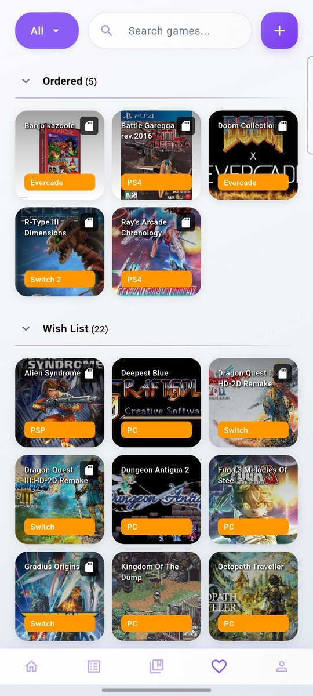
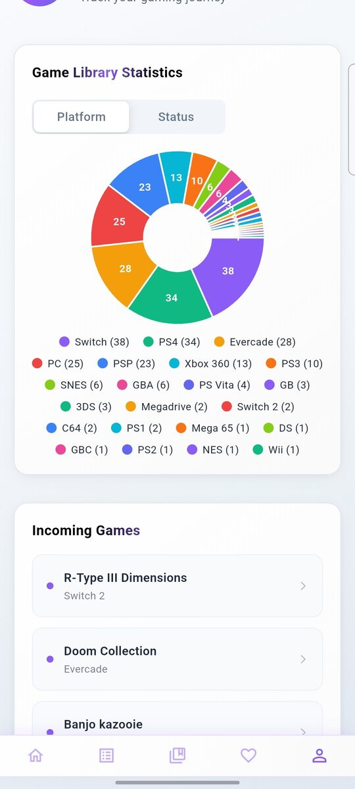
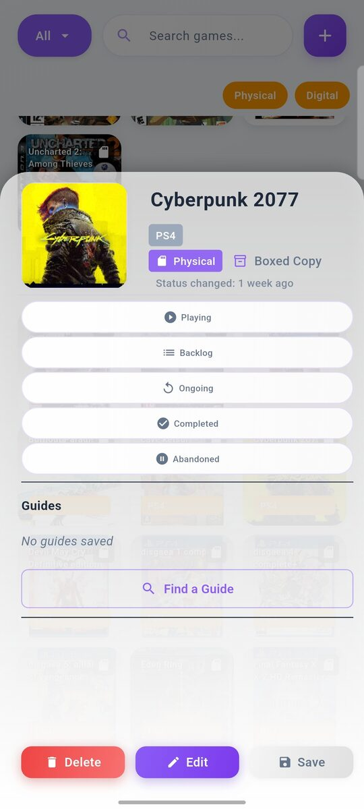
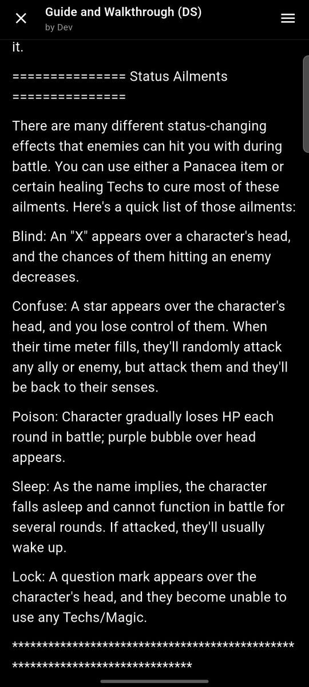
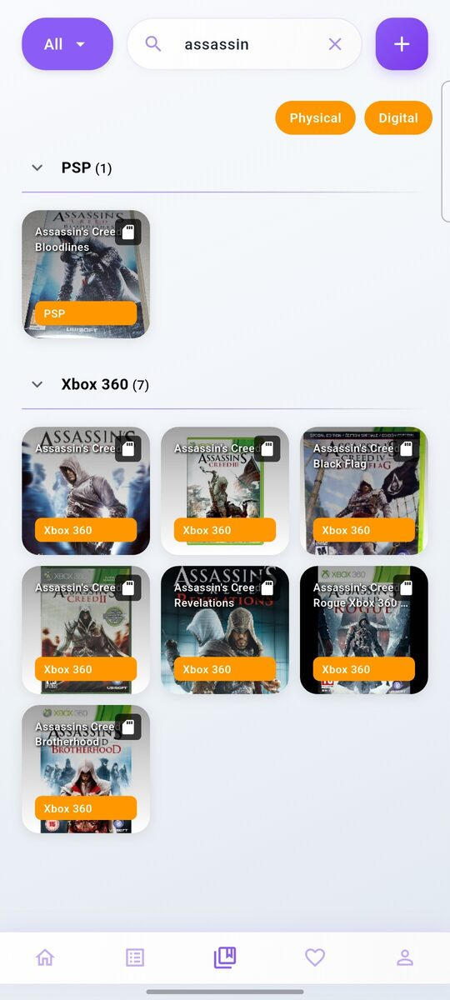
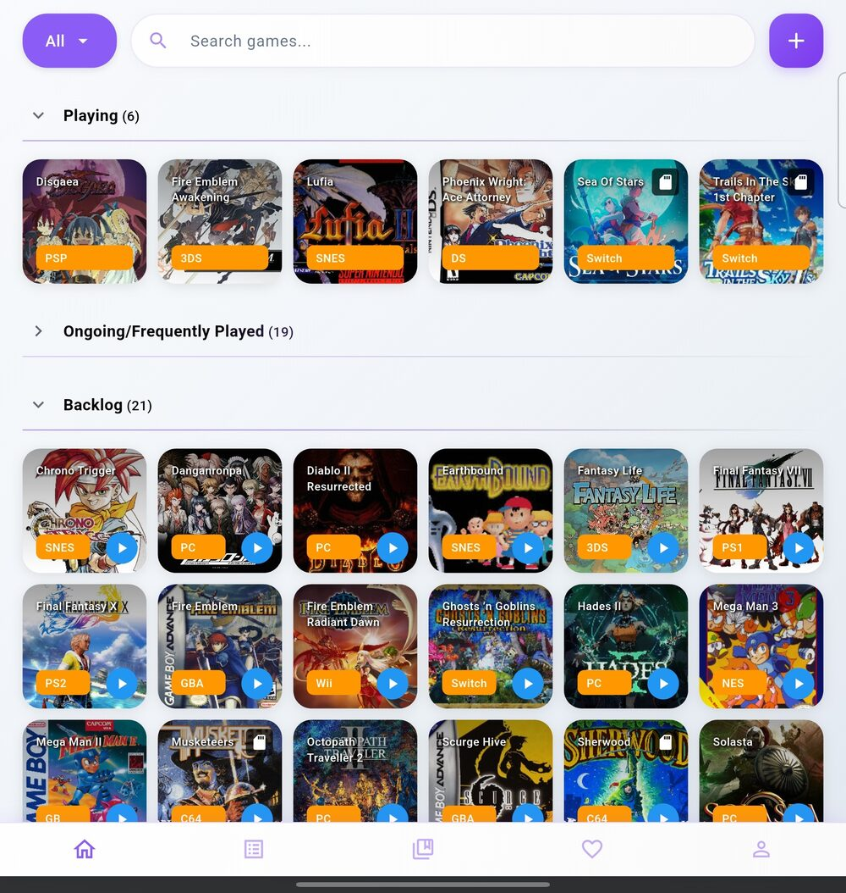

# ChkPnt

> [!IMPORTANT]
> ## 🙋 Help get ChkPnt onto the Play Store
>
> ChkPnt is free and always will be. The code is here for anyone to build, but I'd love non-technical players to be able to install it straight from the Google Play Store.
>
> **Before Google will let me release it, I need at least 12 testers to keep it installed for 2 weeks.** If you have an Android phone, please join the closed test:
>
> 1. **Email [frooglesim@gmail.com](mailto:frooglesim@gmail.com?subject=ChkPnt%20closed%20test)** with the Google account email you use on your phone, and I'll add you to the tester list. The link below won't work until I have.
> 2. **Then join the test:**
>
> ### 👉 [Join the ChkPnt closed test](https://play.google.com/apps/testing/com.frooglesim.chkpnt)
>
> All help is welcome, and thank you!

ChkPnt is an Android app for tracking the games you own or want, and where you are with each one: what you're playing, what's waiting in the backlog, and what's done.

It is built with Flutter. Everything it stores stays on your device. There is no account, no server and no tracking.

<p align="center">
  
  
  
</p>

## What it does

- **Track each Game with a Status**: Wishlist, Ordered, Backlog, Playing, Ongoing, Completed or Abandoned. A Game you own may also have no Status and simply sit in your Collection.
- **File Games under a Platform you name** ("PS5", "Steam", "Switch 2", anything you like), as a Physical or a Digital copy.
- **Separate screens** for what you're playing, your Backlog (sortable by title or by when its Status last changed), your Wishlist and Ordered Games, and your Physical and Digital Collection.
- **Add Games by scanning a barcode** on a boxed game. ChkPnt looks the barcode up to fill in the title and Platform.
- **Give each Game a cover image** taken with the camera, picked from your photos or files, or found with a web image search.
- **Keep Guides with a Game.** Browse GameFAQs inside the app and save a Text Guide, which opens in ChkPnt's own reader at the place you left off, or keep a Web Guide as a link.
- **See statistics**: charts of your library by Status or by Platform, and a list of Games still on the way.
- **Back up and restore** all your Games, images and Guides as a single zip file.

| Change a Game's Status | Read a saved Text Guide | Search your Collection |
| :---: | :---: | :---: |
|  |  |  |

On a tablet or an unfolded foldable, the grids widen to use the extra space:

<p align="center">
  
</p>

The words above (Game, Status, Platform, Collection, Guide) have exact meanings in ChkPnt; [GLOSSARY.md](GLOSSARY.md) defines them.

### Network use

ChkPnt only goes online when you ask it to:

| Feature | Service contacted |
| --- | --- |
| Barcode lookup | [UPCitemdb](https://www.upcitemdb.com/) free trial API (no key; limited to roughly 100 lookups a day per IP address) |
| Cover image search | Bing Images, falling back to Qwant |
| Guides | [GameFAQs](https://gamefaqs.gamespot.com), in an embedded browser |
| Remote cover images | Whichever site hosts the image you picked |

Guides belong to their authors. ChkPnt saves them on your device for your own reading and shows each Guide's attribution.

## Building

### Requirements

- [Flutter](https://docs.flutter.dev/get-started/install) **3.47.9** (stable), which CI uses. Other recent stable versions will probably work.
- The Android SDK and JDK 17 or newer. Android Studio provides both; run `flutter doctor` to confirm Flutter can find them.
- An Android phone with USB debugging enabled, or an Android emulator.

ChkPnt targets Android only. The `linux/`, `windows/` and `web/` folders are Flutter's default scaffolding and are neither tested nor supported.

### Get the code and run it

```bash
git clone https://github.com/froogle/chkpnt.git
cd chkpnt
flutter pub get
flutter run
```

Generated code (`*.g.dart`, `*.freezed.dart`) is committed, so the app builds straight after cloning.

### Release builds and signing

```bash
flutter build apk --release
```

The APK is written to `build/app/outputs/flutter-apk/app-release.apk`.

Without a signing key, release builds are signed with your local debug key. That works for installing on your own devices but not for publishing. To sign with your own key, create `android/key.properties`, which is gitignored and must never be committed:

```properties
storeFile=/absolute/path/to/your-upload-keystore.jks
storePassword=...
keyAlias=...
keyPassword=...
```

To create a keystore, see Flutter's [Build and release an Android app](https://docs.flutter.dev/deployment/android#create-an-upload-keystore) guide. When `android/key.properties` exists, release builds use it.

### Updating an installed release build without losing data

`tool/deploy-device.sh [serial]` builds a release APK, installs it over the existing app with `adb install -r` (keeping its data), and opens it. Use it whenever a release build is already on the device. Debug and release builds are signed with different keys, so `flutter run` or `flutter install` must uninstall an installed release build first, and that deletes its Games.

## Development

### Checks

```bash
tool/check.sh
```

This runs everything CI runs, and must pass before every commit:

1. `build_runner` regenerates code, and the check fails if the committed generated code was out of date.
2. `dart format` must report no changes.
3. `flutter analyze` must report no issues.
4. `flutter test` must pass.

Useful on their own:

```bash
dart run build_runner build                       # after changing a Riverpod, Freezed or Drift source
flutter test --reporter=failures-only <path>      # run some tests, printing only failures
```

### Checking a screen on Android 13

Material's default colours render invisible text on Android 13, so every screen sets its colours explicitly and a changed screen gets checked by eye on Android 13. `tool/start-android-13.sh` boots a headless Android 13 emulator and prints its serial; if the emulator doesn't exist yet, the script prints the commands that create it. Then:

```bash
tool/deploy-device.sh <serial>
adb -s <serial> exec-out screencap -p > screen.png
```

### Project layout

```
lib/
├── models/         Freezed data classes (Game, Guide, backup metadata)
├── repositories/   Drift (SQLite) storage behind the GameRepository interface
├── providers/      Riverpod state, generated with riverpod_generator
├── services/       Barcode lookup, image search, Guides, backup and restore
├── screens/        One folder per screen, with its own widgets/ and widgets/animations/
├── shared/widgets/ Widgets used by two or more screens
├── styles/         All colours, text styles and layout constants
└── utils/
test/               Mirrors lib/
tool/               Check, deploy and emulator scripts
docs/adr/           Architecture decision records
```

### Further reading

- [CODING_STANDARDS.md](CODING_STANDARDS.md): the rules every change follows, covering styling, state, layout and tests.
- [GLOSSARY.md](GLOSSARY.md): ChkPnt's domain language, which code, UI text and tests all use.
- [docs/adr/](docs/adr/): recorded architecture decisions.
- [CLAUDE.md](CLAUDE.md) and [docs/agents/](docs/agents/): instructions for AI coding agents working in this repo. Issues they work from live as markdown files under `.scratch/`.

## Contributing

Issues and pull requests are welcome. Please read [CODING_STANDARDS.md](CODING_STANDARDS.md) first, use the terms in [GLOSSARY.md](GLOSSARY.md), write British English (colour, centre, organisation), and make sure `tool/check.sh` passes.

## Licence

ChkPnt is released under the [MIT Licence](LICENSE). Copyright © 2025 Peter Wright.
